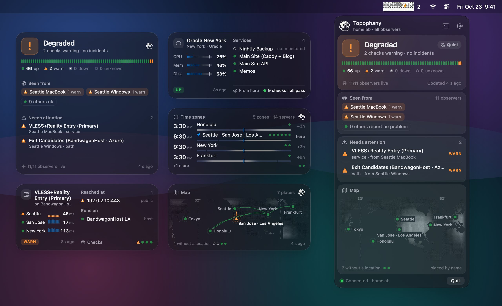
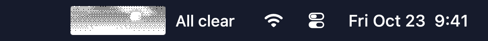
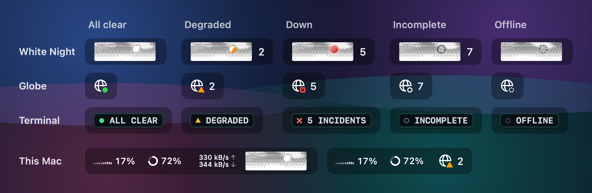
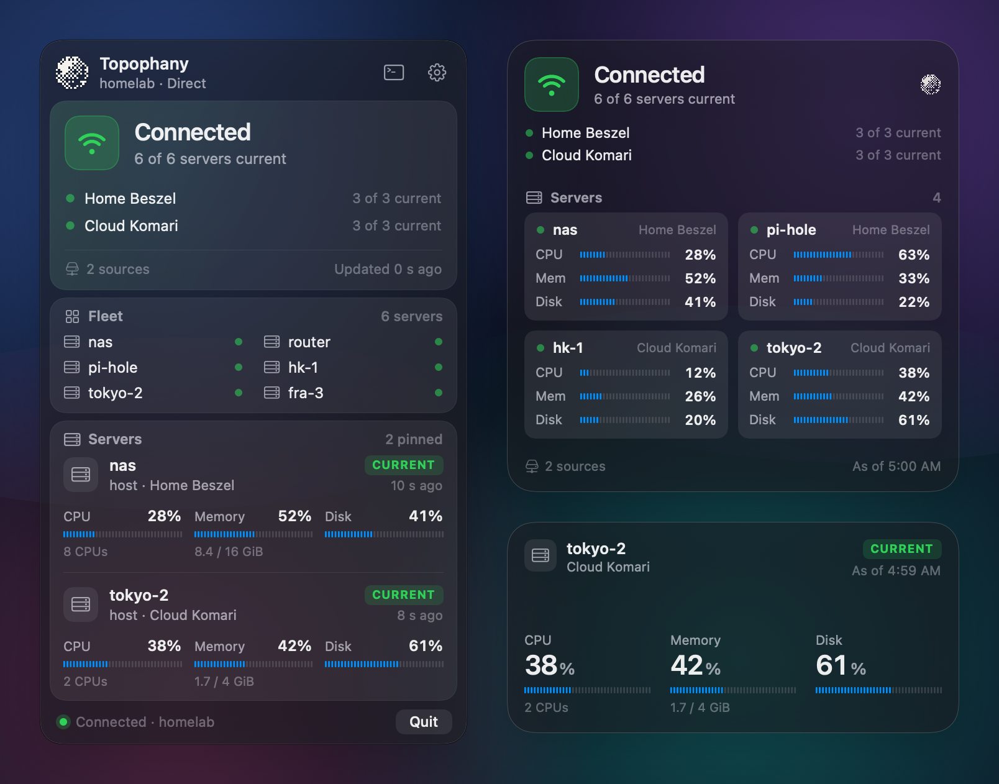
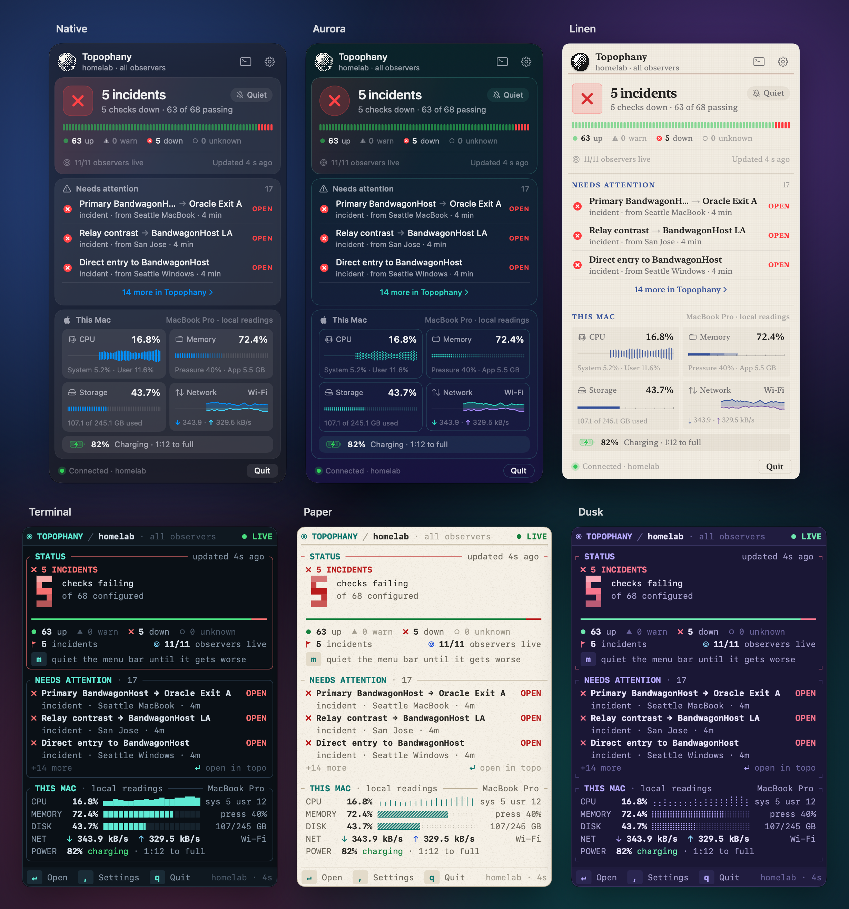

<p align="center">
  
</p>

<h1 align="center">topophany-bar</h1>

<p align="center">
  <strong>Your homelab, servers and services, at a glance in the macOS menu bar.</strong><br>
  A derivative project of <a href="https://github.com/WhitenWhiten/topophany">Topophany</a> that brings its network monitoring to the menu bar and desktop widgets, and reads Beszel and Komari directly.
</p>

<p align="center">
  macOS 26+ · Pre-release · English / 日本語 / 简体中文
</p>

<p align="center">
  <a href="#get-started">Get started</a> ·
  <a href="#the-menu-bar">Menu bar</a> ·
  <a href="#beszel-and-komari">Beszel and Komari</a> ·
  <a href="#themes">Themes</a> ·
  <a href="#desktop-widgets">Widgets</a> ·
  <a href="#contributing">Contribute</a>
</p>

<p align="center">
  
  <br><sub>A demo network with 66 of 68 checks passing and two warnings. Every image in this README is rendered by the app's own SwiftUI views from synthetic demo data.</sub>
</p>

See what needs attention from the menu bar, open the panel to find where the problem is seen, and jump into Topophany's terminal UI for the evidence. No collector? Point the app at a Beszel Hub or a Komari server and keep their servers in view instead.

## What you can do

- **Check your network at a glance.** The menu bar shows the current status as an icon, count or short phrase. Distinct shapes make warnings, incidents and missing data readable even without color.
- **Find where a problem is seen.** The panel brings together incidents, affected applications and the observers reporting trouble. Open an attention item in Topophany's terminal UI to investigate.
- **Read Beszel and Komari directly.** Pick servers from a Beszel Hub or a Komari server and watch their CPU, memory and disk, with no Topophany collector to run.
- **Put your servers on a map.** Explore locations and connections, browse your fleet by provider, and see the local time where your servers run.
- **Keep important services close.** Pin service cards with recent checks, latency and uptime, or server cards with CPU, memory and disk readings.
- **Make it yours.** Choose from six themes, and give the menu bar White Night's animated sky or an icon or animation of your own.
- **Add desktop widgets.** Choose Status, Server, Service, Map or Time Zones, with sizes and themes to suit your desktop.
- **Watch this Mac too.** Show local CPU, memory, storage, network and battery readings in the panel; optionally put CPU, memory and network in the menu bar.

## The menu bar

<p align="center">
  
</p>

**White Night** is the built-in animated icon: a dithered night sky, printed in ink on paper, whose moon is the status. The moon is full when all is clear, in partial eclipse while something is degraded, and a blood moon while something is down. An outline means what's known is incomplete, and a dashed outline that nothing current is known. Its clouds drift on a 24-second loop, and each change dissolves through the dither. Choose it in **Settings → Appearance**.

<p align="center">
  
</p>

- **Bring your own icon.** Import a PNG, JPEG, GIF or APNG, or a folder of frames. Name files or folders `clear`, `warning` and `error` to make a status pack whose art changes with the status; `unknown` and `offline` are optional. For a status a pack has no frames for, its clear frames play without color, with a badge beside them.
- **Choose what it says.** Show a symbol, a count or words, with or without status colors. White Night and your own icons come in small, medium and large, at the animation speed you choose. Reduce Motion keeps the item still.
- **Quiet an alert you already know about.** **Quiet Until It Gets Worse** softens the menu bar alert until the situation worsens or clears.
- **Keep an eye on this Mac.** Put its CPU, memory and network readings beside the item.

## Beszel and Komari

<p align="center">
  
  <br><sub>One profile reading a <a href="https://github.com/henrygd/beszel">Beszel</a> Hub and a <a href="https://github.com/komari-monitor/komari">Komari</a> server directly: the panel, a large Status widget and a medium Server widget.</sub>
</p>

topophany-bar can read servers straight from a Beszel Hub or a Komari server through `topo`, with no Topophany collector or handwritten topology. A profile can hold several sources, Beszel and Komari mixed; equal server names in different sources remain separate.

### Add a source

1. Open **Settings → Data sources**, set **Read from** to **Beszel or Komari direct**, and add a source.
2. Sign in to it:
   - **Beszel:** enter the Hub's address and use your account and password to **Test connection**. An API token is there for accounts whose sign-in method needs it.
   - **Komari:** enter the server's address and an administrator API key, or choose **Public servers only** to read the servers it shows without one.
3. Select up to 20 servers per source and save.

Editing an existing source uses its saved authentication unless you choose to sign in again. The app never saves your password or API key.

Direct requires a `topo` whose capabilities advertise **Direct v1 / config API 1**, and Komari a `topo` that lists `komari` among its direct adapters; choose or download a newer executable in **Settings → General** if needed. Sources must be a Beszel Hub or a Komari 1.6 server.

### What you see

- **Status, Fleet, Servers and This Mac.** The other sections show what a Topophany collector judges, and return as you left them when you read from one.
- **Each source's own samples.** CPU, memory and disk use each source's sample timestamps: the Hub's primary disk for Beszel, and for Komari the aggregate its agent reports, not one mount. A new Komari source is read every 30 seconds, since Komari keeps only about a minute of reports.
- **No verdict that isn't there.** Connection status describes data acquisition, and missing or expired measurements stay unknown; neither judges a server's health. Its card says how it is read instead, **Current**, **Stale** or **No samples**, with its CPUs and memory size.
- **Widgets as snapshots.** Direct widgets show resources labelled **As of** and expire at their original deadlines; WidgetKit does not promise a five-second refresh.

Closing the app stops its own collection; a terminal opened on its own keeps polling on its own.

### Through a Topophany collector

Komari and Beszel servers can also reach the bar through a collector: add a `komari` or `beszel` source and its resource checks to the collector's topology, as Topophany's adapter guides describe. Their cards say where they're read from in the provider's place ("host · Komari Monitor"), and keep the collector's verdict where its checks judge one. **Settings → Data sources** lists the Komari and Beszel sources the collector reports, with their servers.

## Themes

<p align="center">
  
  <br><sub>The same simulated outage in every built-in theme. Each draws its own meters: bars, dots, a scale, blocks, halftone and braille.</sub>
</p>

| Theme | Look |
|---|---|
| **Native** | macOS materials in SF Pro, light or dark with the system |
| **Aurora** | A northern sky at night: a teal-to-violet ground, hairline cards and dotted meters, in SF Pro Rounded |
| **Linen** | Matte and woven, set in New York, with ruled sections and small-capital titles |
| **Terminal** | Topophany's terminal UI, in its own palette and SF Mono |
| **Paper** | The terminal UI printed on warm paper, with grain, rules and halftone meters |
| **Dusk** | The terminal UI at nightfall: pastels on deep indigo, with braille meters |

## Desktop widgets

<p align="center">
  
  <br><sub>A healthy demo network in small, medium and large widgets across all six themes.</sub>
</p>

Choose **Status**, **Server**, **Service**, **Map** or **Time Zones**, from small up to extra large where the type has room, then edit a widget to pick the server, service, map view or theme. See [Add widgets](#add-widgets) to set them up.

## Get started

topophany-bar is currently pre-release. [Build and launch the app from source](docs/DEVELOPMENT.md#building) to try it today. A local ad hoc build runs the menu bar app; desktop widgets require a build signed with an Apple Developer team and a shared App Group.

### Connect your network

1. **Set up Topophany.** You need a running Topophany collector for live network monitoring. If this is your first time using it, start with [Topophany's setup guide](https://github.com/WhitenWhiten/topophany#monitor-your-own-network). To watch Beszel or Komari servers without a collector, [add a direct source](#add-a-source) instead.
2. **Open topophany-bar.** If it cannot find a compatible `topo`, choose **Download topo**. The app downloads the command-line companion from Topophany's releases and verifies its SHA-256 checksum.
3. **Sign in.** Open **Settings → General → Sign In…** to run `topo login` in your terminal. If you already use Topophany, select your saved **Profile** instead.
4. **Click the menu bar icon.** Your network's status, observers, applications and fleet appear in the panel. Choose a single observer in **Settings → General → View** to see the network from that location.

The app needs a `topo` version with `monitor stream` protocol 1. If your installed copy is too old, use the download offered in the app or choose a compatible binary in Settings.

### Try a demo first

Once the app and a compatible `topo` are installed, quit the app if it is running and launch the built-in preview network:

```sh
open -a topophany-bar --args -preview 1
```

This shows a simulated outage without a collector or credentials. Use `-preview 0` for a calm network. Quit and reopen the app normally to return to your saved connection. If you built from source without installing it in Applications, use the path to your built `.app` in place of `topophany-bar`.

### Add widgets

With a signed build installed, open topophany-bar once, then right-click the desktop and choose **Edit Widgets**. Search for **Topophany**, add a widget, and edit it to choose the server, service, map view or theme where available. Keep the menu bar app running to supply fresh data to the widgets.

## Make it yours

| In Settings | What you can change |
|---|---|
| **General** | Profile, observer, refresh rate, launch at login, language and a global shortcut to toggle the panel |
| **Appearance** | Theme, panel appearance and text size; the menu bar icon (the globe, White Night or your own), its size, speed, text, status colors and motion, and This Mac's readings beside it |
| **Sections** | Visible sections and their order, pinned servers and services, map framing and time zones |
| **This Mac** | Local readings, a collector-backed card for this Mac, or neither |
| **Data sources** | Read from a Topophany collector, or from Beszel and Komari sources directly |

Drag the panel's bottom edge to resize it. **Lock Geo Map** is enabled by default so scrolling moves the panel; pinch and keyboard zoom remain available.

## How it fits with Topophany

[Topophany](https://github.com/WhitenWhiten/topophany) runs the checks, collects evidence and determines network health. **topophany-bar is its macOS companion:** it reads that information through `topo` and presents it in the menu bar, panel and widgets. In direct mode, `topo` reads your Beszel and Komari sources itself, without a collector. Closing the app does not stop your collectors or workers.

Expired evidence is shown as unavailable or cached, so an old healthy result does not remain current. Sign-in credentials stay with `topo`; the app does not read or store tokens. This Mac's local readings stay on the Mac and are never uploaded.

## Contributing

Bug reports, feature ideas, translations and pull requests are welcome. [Open an issue](https://github.com/WhitenWhiten/topophany-bar/issues) with your macOS version, app and `topo` versions, and steps to reproduce the problem. Screenshots help; remove private network details before sharing them.

For code contributions, see the [development guide](docs/DEVELOPMENT.md), [design notes](design/DESIGN.md) and [stream protocol](docs/PROTOCOL.md). The README's images are rendered from the app's views; [regenerate them](docs/DEVELOPMENT.md#readme-screenshots) after changing what they show.

If you find this useful, consider starring [Topophany](https://github.com/WhitenWhiten/topophany), the upstream project that makes it possible.

## License

topophany-bar is source-available under the [PolyForm Noncommercial License 1.0.0](LICENSE). Noncommercial use is permitted under that license; commercial use requires a separate license. See [LICENSE](LICENSE) for the full terms and [open an issue](https://github.com/WhitenWhiten/topophany-bar/issues) for licensing inquiries.

[Topophany](https://github.com/WhitenWhiten/topophany) itself is MIT-licensed. Provider logos and other third-party assets retain their own terms; see [Third-party notices](THIRD-PARTY-NOTICES.md).
