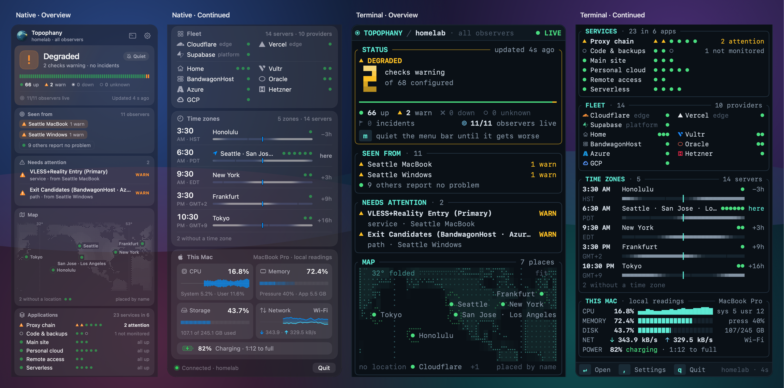
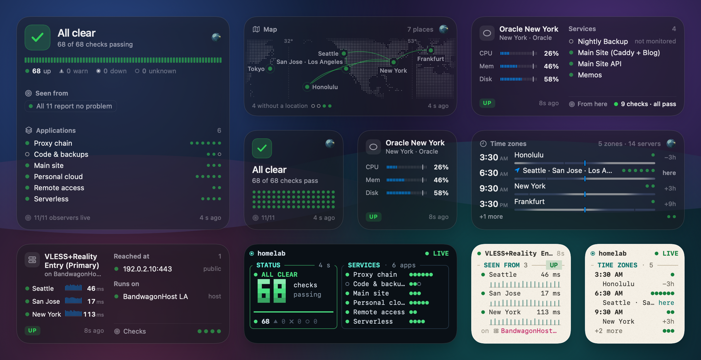

# topophany-bar

**A derivative project of [Topophany](https://github.com/WhitenWhiten/topophany), bringing its network monitoring to the macOS menu bar and desktop widgets.**

<p align="center">
  
  <br><sub>A demo network with 66 of 68 checks passing, two warnings and no open incidents, in Native (left pair) and Terminal (right pair). Each panel continues into the next column, split between cards; in the app, it scrolls to fit your display. Click the image for full resolution.</sub>
</p>

Keep your homelab, servers and services in view while you work. See what needs attention from the menu bar, open the panel to find where the problem is seen, and jump into Topophany's terminal UI for the evidence.

[Get started](#get-started) · [Widgets](#desktop-widgets) · [Customize](#make-it-yours) · [Contribute](#contributing) · [Topophany](https://github.com/WhitenWhiten/topophany)

**macOS 26+ · Pre-release · English / 日本語 / 简体中文**

## What you can do

- **Check your network at a glance.** The menu bar shows the current status as an icon, count or short phrase. Distinct shapes make warnings, incidents and missing data readable even without color.
- **Find where a problem is seen.** The panel brings together incidents, affected applications and the observers reporting trouble. Open an attention item in Topophany's terminal UI to investigate.
- **Put your servers on a map.** Explore locations and connections, browse your fleet by provider, and see the local time where your servers run.
- **Keep important services close.** Pin service cards with recent checks, latency and uptime, or server cards with CPU, memory and disk readings.
- **Add desktop widgets.** Choose Status, Server, Service, Map or Time Zones, with sizes and themes to suit your desktop.
- **Watch this Mac too.** Show local CPU, memory, storage, network and battery readings in the panel; optionally put CPU, memory and network in the menu bar.

## Desktop widgets

<p align="center">
  
  <br><sub>A healthy demo network in small, medium and large widgets across Native, Terminal and Paper, including a medium Map and four small widgets. All images use synthetic demo data rendered by the app's native SwiftUI views. Click for full resolution.</sub>
</p>

## Get started

topophany-bar is currently pre-release. [Build and launch the app from source](docs/DEVELOPMENT.md#building) to try it today. A local ad hoc build runs the menu bar app; desktop widgets require a build signed with an Apple Developer team and a shared App Group.

### Connect your network

1. **Set up Topophany.** You need a running Topophany collector for live network monitoring. If this is your first time using it, start with [Topophany's setup guide](https://github.com/WhitenWhiten/topophany#monitor-your-own-network).
2. **Open topophany-bar.** If it cannot find a compatible `topo`, choose **Download topo**. The app downloads the command-line companion from Topophany's releases and verifies its SHA-256 checksum.
3. **Sign in.** Open **Settings → General → Sign In…** to run `topo login` in your terminal. If you already use Topophany, select your saved **Profile** instead.
4. **Click the menu bar icon.** Your network's status, observers, applications and fleet appear in the panel. Choose a single observer in **Settings → General → View** to see the network from that location.

The app needs a `topo` version with `monitor stream` protocol 1. If your installed copy is too old, use the download offered in the app or choose a compatible binary in Settings.

### Try a demo first

Once the app and a compatible `topo` are installed, quit the app if it is running and launch the built-in preview network:

```sh
open -a topophany-bar --args -preview 1
```

This shows a simulated outage without a collector or credentials. Use `-preview 0` for a calm network. Quit and reopen the app normally to return to your saved connection. If you built from source without installing it in Applications, use the path to your built `.app` in place of `topophany-bar`.

### Add widgets

With a signed build installed, open topophany-bar once, then right-click the desktop and choose **Edit Widgets**. Search for **Topophany**, add a widget, and edit it to choose the server, service, map view or theme where available. Keep the menu bar app running to supply fresh data to the widgets.

## Make it yours

| In Settings | What you can change |
|---|---|
| **General** | Profile, observer, refresh rate, launch at login, language and a global shortcut to toggle the panel |
| **Appearance** | Native, Terminal, Aurora, Linen, Paper and Dusk themes; menu bar text, colors, motion and icons, including imported images or animations. White Night's moon shows the status itself, and a blood moon means something is down; name imported files `clear`, `warning` and `error` to make your own |
| **Sections** | Visible sections and their order, pinned servers and services, map framing and time zones |
| **This Mac** | Local readings, a collector-backed card for this Mac, or neither |

Drag the panel's bottom edge to resize it. **Lock Geo Map** is enabled by default so scrolling moves the panel; pinch and keyboard zoom remain available. When you already know about an incident, **Quiet Until It Gets Worse** softens the menu bar alert until the situation worsens or clears.

## How it fits with Topophany

[Topophany](https://github.com/WhitenWhiten/topophany) runs the checks, collects evidence and determines network health. **topophany-bar is its macOS companion:** it reads that information through `topo` and presents it in the menu bar, panel and widgets. Closing the app does not stop your collectors or workers.

Expired evidence is shown as unavailable or cached, so an old healthy result does not remain current. Sign-in credentials stay with `topo`; the app does not read or store tokens. This Mac's local readings stay on the Mac and are never uploaded.

## Contributing

Bug reports, feature ideas, translations and pull requests are welcome. [Open an issue](https://github.com/WhitenWhiten/topophany-bar/issues) with your macOS version, app and `topo` versions, and steps to reproduce the problem. Screenshots help; remove private network details before sharing them.

For code contributions, see the [development guide](docs/DEVELOPMENT.md), [design notes](design/DESIGN.md) and [stream protocol](docs/PROTOCOL.md).

If you find this useful, consider starring [Topophany](https://github.com/WhitenWhiten/topophany), the upstream project that makes it possible.

## License

topophany-bar is source-available under the [PolyForm Noncommercial License 1.0.0](LICENSE). Noncommercial use is permitted under that license; commercial use requires a separate license. See [LICENSE](LICENSE) for the full terms and [open an issue](https://github.com/WhitenWhiten/topophany-bar/issues) for licensing inquiries.

[Topophany](https://github.com/WhitenWhiten/topophany) itself is MIT-licensed. Provider logos and other third-party assets retain their own terms; see [Third-party notices](THIRD-PARTY-NOTICES.md).

### Beszel and Komari direct

In Settings → Data sources, choose **Beszel or Komari direct** and add a source.
For a Beszel Hub, use your account and password to **Test connection**; an API
token is there for accounts whose sign-in method needs it. For a Komari server,
use an administrator API key, or **Public servers only** to read the servers it
shows without one. Select up to 20 servers per source and save. Editing an
existing source uses saved authentication unless you choose to sign in again.
The app never saves your password or API key.

Direct requires a `topo` whose capabilities advertise **Direct v1 / config API 1**,
and Komari a `topo` that lists `komari` among its direct adapters. Choose or
download a newer executable in General if needed. It needs a Beszel Hub or a
Komari 1.6 server, but no Topophany collector or handwritten topology. A profile
can hold several sources, Beszel and Komari mixed; equal server names in
different sources remain separate.

CPU, memory and disk use each source's sample timestamps: the Hub's primary disk
for Beszel, and for Komari the aggregate its agent reports, not one mount. A new
Komari source is read every 30 seconds, since Komari keeps only about a minute
of reports. Connection status describes data acquisition. Missing and expired
measurements stay unknown. Neither judges health for a server, so its card says
how it is read instead: **Current**, **Stale** or **No samples**, with its CPUs
and memory sizes. Closing the bar stops its own collection; an independently
opened terminal polls on its own. Direct widgets are resource snapshots labelled
**As of** and expire at their original deadlines; WidgetKit does not promise a
five-second refresh.

### Collector sources

Komari and Beszel servers can also reach the bar through a Topophany collector:
add a `komari` or `beszel` source and its resource checks to the collector's
topology, as Topophany's adapter guides describe. Their cards say where they're
read from in the provider's place ("host · Komari Monitor"), and keep the
collector's verdict where its checks judge one. Settings → Data sources lists the
Komari and Beszel sources the collector reports, with their servers.
